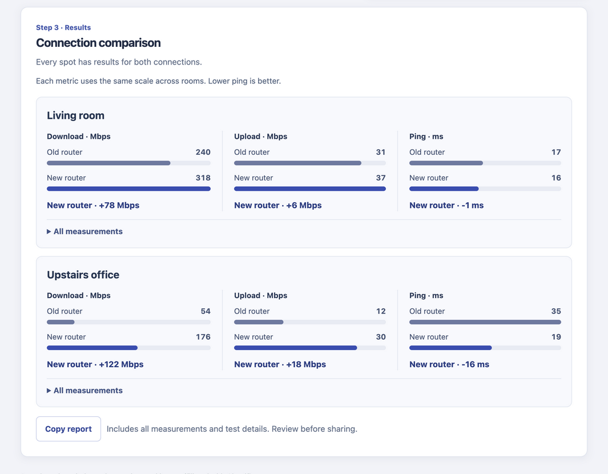

# Speedmap

**Find out whether a different router, access point, or connection improves the rooms you use.** Speedmap runs a live internet speed test and lets you repeat it at the same spots on a floor plan. The comparison puts both sets of results side by side, room by room.

[Open Speedmap](https://bad33ndj3.github.io/speedmap/)

## Test your connection

Open **Speed test** and select **Run speed test** to test your current connection. Download and upload speeds update as the test runs, alongside latency and jitter when available. Quick tests stay on screen until you run another test or leave the page.

## Compare two setups

1. **Draw up your route.** Choose a floor plan image and add a spot for each place you want to test. A screenshot or photo works. Rename spots to match the rooms. Drag markers to adjust their positions.
2. **Name both setups.** For example, use “Router in hallway” and “Router in living room.” Stand at the selected spot and connect to the setup shown before starting the test.
3. **Repeat the route.** After each test, Speedmap suggests the next unmeasured spot. After the first round, it suggests the second setup. Switch networks or change your setup before you start that round.
4. **Open the comparison.** Read separate download, upload, and ping charts for each room. Each metric uses a common scale across rooms, and the signed change is the second setup minus the first. Open **All measurements** for latency under load. Speedmap uses the latest test for each spot and setup. **Copy report** includes the comparison and the full measurement history.

For a fair comparison, use the same device and stand in the same places for both rounds.



## Keep, move, or clear your map

Your plan, spots, and saved measurements are restored when you reopen Speedmap in the same browser. Open **Move or back up your map** to download a backup. Select **Clear floor plan** from the same menu to start over. Keep a backup before clearing the map or replacing it with another plan. Both actions remove the old spots and measurements after confirmation.

On desktop, **Open on phone** shows a code your phone can scan to open the page. To continue with the same map, download a backup on the original device and select **Restore backup** on the phone. Restoring a backup replaces the data already in that browser.

## What leaves your device

Speedmap stores your map and its history in your browser. A test sends traffic and measurement results to Cloudflare through its [open-source speed test engine](https://github.com/cloudflare/speedtest), loaded from jsDelivr. A test can use hundreds of megabytes. The copied report includes test timestamps and browser details, so review it before sharing.

Browser storage can run out or be cleared. If saving a measurement fails, download a backup while the page is still open.

## Run locally

From the repository directory, start a static server and open [localhost:8000](http://localhost:8000/). A live test requires internet access.

```sh
python3 -m http.server 8000
```

Run the automated checks with Node.js 22. The tests use simulated measurements and send no test traffic.

```sh
node --test tests/*.test.mjs
```

The [GitHub Pages workflow](.github/workflows/pages.yml) runs these checks and publishes the static files when changes reach `main`.

## License

Speedmap is independent of Cloudflare and released under the [MIT License](LICENSE). QR codes are generated locally using [qrcode-generator](vendor/LICENSE-qrcode.txt), also under the MIT License.
