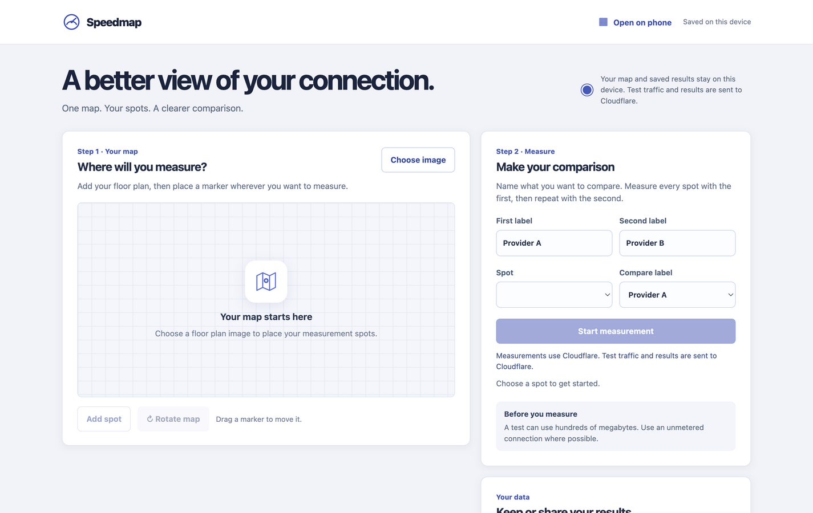

# Speedmap

A static, independent app for comparing internet speed at spots on your own floor plan.

[See the mobile view](docs/mobile.png)

## Run locally

Run `python3 -m http.server 8000` from this directory, then visit `http://localhost:8000/`. No build or account is needed. For the measurement itself the browser needs internet access.

Choose a PNG, JPEG, WebP or GIF image, add named spots, and drag each marker into place. Rotate the map if needed; markers rotate with it. Give both comparison labels your own names. Measure every spot on the first connection, switch connections, and repeat. The app retains every measurement; the page compares the most recent measurement for each spot. Copy for agent includes the comparison and all detailed results. If copying is unavailable, select the displayed text manually. Export JSON for a backup and import it to restore your map and measurements; importing replaces current data.

## Privacy and storage

The image, spots and results are stored in this browser's local storage and are not sent to a Speedmap server. Browser storage can be cleared or evicted; export backups. Large images can exceed the browser quota. When saving fails the existing stored data is preserved and a warning is shown. A completed measurement that cannot be saved remains in memory until the page closes: export it immediately.

A measurement uses the official [Cloudflare speed test engine](https://github.com/cloudflare/speedtest), version 1.17.0, loaded from jsDelivr. Cloudflare receives test traffic and completed measurement results. A test can use hundreds of megabytes. The report includes the browser user agent and timestamps; review it before sharing. Browsers cannot reliably provide Wi-Fi signal, band or network name, so these are not measured. Speedmap is not affiliated with Cloudflare.

## GitHub Pages preparation

All application paths are relative and work under a repository subpath. The GitHub Actions workflow checks the application and deploys the static site to GitHub Pages when changes reach the main branch. Set the Pages source to GitHub Actions in repository settings. Test the actual Pages URL and mobile Safari after deployment; local testing does not establish those work.

## Checks

Run `node --test tests/*.test.mjs` for deterministic engine tests. No real test traffic is sent by those tests.

On desktop, **Open on phone** shows a QR code for the current page address. It does not transfer data: export a JSON backup and import it on the phone. Localhost addresses only work on the same device. The QR code is generated locally using qrcode-generator 1.4.4 (MIT), included in `vendor/`.

## License

MIT licensed; see [LICENSE](LICENSE). The included QR library has its own [license](vendor/LICENSE-qrcode.txt).
